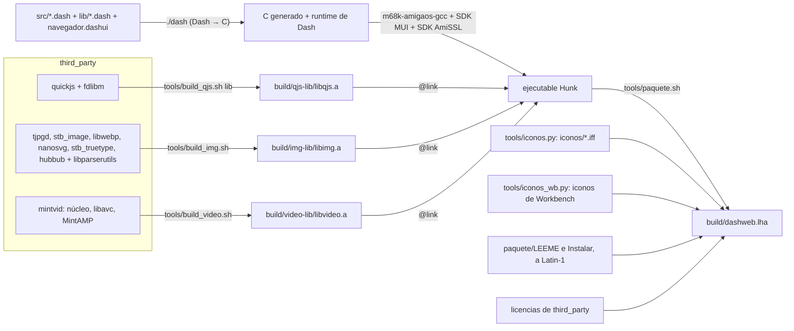

# 09. Entorno, construcción y entrega

Qué hace falta para compilar dashweb, cómo se construye cada pieza, cómo se prueba en el emulador y cómo se hace y
publica el paquete para el Amiga.

## 1. Repositorios y ramas

| Repositorio | Dónde | Rama | Qué |
|---|---|---|---|
| Tachyon (`FreeMEM/tachyon`, antes dashweb) | `~/Projects/tachyon` | `dev` para trabajar, `main` para publicar | El navegador |
| Dash (`FreeMEM/dash`) | `~/Projects/FreeMEMLang/.worktrees/dashweb` (worktree) | `dashweb` (sale de `main`) | El compilador con lo que dashweb ha necesitado (tareas D) |

Las ramas se suben y se fusionan por PR cuando lo decide el responsable. La variable `DASH` apunta a la carpeta de Dash
(por defecto `~/Projects/FreeMEMLang/.worktrees/dashweb`).

## 2. Herramientas

| Herramienta | Versión / origen | Para qué | Cómo se consigue |
|---|---|---|---|
| Python | 3.10 o más, con `lark` | El compilador de Dash y los scripts | Paquete del sistema; `pip install lark` |
| `m68k-amigaos-gcc` | GCC de bebbo, en `/opt/amiga` | Compilar el C que genera Dash y las librerías | Se compila una vez (`docs/INSTALACION.md` de Dash) |
| SDK de MUI 5 | — | Cabeceras de MUI | `tools/get_mui_sdk.sh` de Dash, a `~/.cache/dash-mui` |
| SDK de AmiSSL 5.1+ | — | Cabeceras de AmiSSL | `tools/get_amissl.sh` de Dash, a `~/.cache/dash-amissl` |
| FS-UAE | 3.2 | Ejecutar y probar en un Amiga emulado | Paquete del sistema |
| ROM Kickstart 3.1 (A1200) y 3.2 | Propias | El emulador | No se distribuyen |
| Lhasa (`lha`) | — | Comprobar el `.lha` | Paquete del sistema |
| Chrome | — | `tools/comparar_chrome.py` | Opcional |
| Node.js | — | El plugin de VS Code (opcional) | Opcional |

Nada con licencia que lo impida va a git (SDK de MUI, AmiSSL, ROMs, Workbench): lo bajan scripts a `~/.cache`.

## 3. Sistemas para el emulador

Se preparan una vez, con los scripts de Dash y de dashweb:

| Sistema | Contenido | Script |
|---|---|---|
| `~/.cache/dash-emu/sys31` | Ficheros de un Workbench 3.1 (Libs, C, Classes...) | `tools/emu_sys_from_hdf.sh` (Dash) desde un disco de Amiberry/WinUAE |
| `sys31mui` | `sys31` + MUI 5 | `tools/emu_sys_mui.sh` (Dash) |
| `sys31ssl` | `sys31` + AmiSSL | `tools/emu_sys_amissl.sh` (Dash) |
| `sys31web`, `sys31muisslweb` | Un sistema con AmiSSL (y MUI) más las fuentes del Workbench y las vectoriales | `tools/emu_sys_fuentes.sh` (dashweb) sobre `sys31ssl` o uno con MUI |
| `sys32rtg` | AmigaOS 3.2 con Picasso96 (uaegfx) y MUI 5 | `tools/emu_sys_rtg.sh` (dashweb) |
| `sys32rtg38` | `sys32rtg` con MUI 3.8 de Aminet | A mano |

Variables de entorno:

```bash
export DASH=~/Projects/FreeMEMLang/.worktrees/dashweb
export DASH_KICKSTART="/ruta/kick31_a1200.rom"           # sin ella: AROS, y los resultados no valen
export DASH_KICKSTART_32="/ruta/kick323_a1200.rom"       # máquina rtg
export DASH_EMU_SYS=~/.cache/dash-emu/sys31
export DASH_EMU_SYS_MUI=~/.cache/dash-emu/sys31mui
export DASH_EMU_SYS_SSL=~/.cache/dash-emu/sys31ssl
export DASH_EMU_SYS_32_SSL=~/.cache/dash-emu/sys32ssl
```

## 4. Cadena de construcción



### 4.1 Librerías de C

| Script | Salida | Contiene | Opciones de compilación |
|---|---|---|---|
| `tools/build_qjs.sh lib` | `build/qjs-lib/libqjs.a` + `quickjs.h` | QuickJS, libregexp, libunicode, cutils, dtoa, fdlibm | `-m68020 -m68881 -O2 -fomit-frame-pointer -fbbb=abcfhilmnpsz0 -fno-isolate-erroneous-paths-dereference -fno-delete-null-pointer-checks -fwrapv` (sin FPU: `QJS_CPU=""`) |
| `tools/build_img.sh` | `build/img-lib/libimg.a` | TJpgDec, stb_image, libwebp (decodificador), nanosvg, stb_truetype, Hubbub + libparserutils | `-noixemul -O2 -fomit-frame-pointer -fbbb=abcfhilmnpz0 -fno-delete-null-pointer-checks -m68020 -m68881`; Hubbub sin el optimizador de bebbo (`-fbbb=-`) |
| `tools/build_video.sh` | `build/video-lib/libvideo.a` | MintVID (MP4, AVI, MKV, TS; H.264 con libavc y su ensamblador, MPEG-1, MPEG-4...), MintAMP (AAC-LC, MP3, Paula) | `-noixemul -O2 -std=c99 -m68020-60 -m68881 -fomit-frame-pointer -fno-strict-aliasing -fwrapv ...`; `SIN_SONIDO=1` sin audio |

Opciones del optimizador de bebbo: se quitan las pasadas que generaban código erróneo (`e`, `r` en QuickJS; `s` en
libimg). Lo cuenta la bitácora (28d).

Otros binarios de QuickJS para probarlo suelto: `tools/build_qjs.sh 000` (68000, sin FPU) y
`tools/build_qjs.sh 020fpu -m68020 -m68881`.

### 4.2 El programa

```bash
cd $DASH
PYTHONPATH=$DASH ./dash ~/Projects/tachyon/src/dashweb.dash -o dashweb        # el navegador
PYTHONPATH=$DASH ./dash ~/Projects/tachyon/src/visor.dash -o visor            # el visor sin MUI
```

- `./dash` traduce a C, añade el runtime (con MUI si se usa `mui_*`, con AmiSSL si se usa `tls_*`), las cabeceras de los
  SDK y las librerías de `@link`, y llama a gcc.
- La pila mínima sale de las directivas `@stack` de los módulos (256 KB por QuickJS, 400.000 bytes por el vídeo).
- Opciones útiles: `--fpu` (68020 + 68881), `--memcheck`, `--profile`, `-O0`.
- **A revisar:** los tests compilan con `--fpu` y `tools/paquete.sh` no (ver R-01 en
  [10](10_RIESGOS_Y_PENDIENTES.md)).

### 4.3 Herramientas generadoras

| Script | Genera | Cuándo |
|---|---|---|
| `tools/preludio.py` | `lib/jsdom_preludio.dash` desde `lib/jsdom_preludio.js` | Al cambiar el preludio (los tests lo comprueban) |
| `tools/gen_entidades.py` | `lib/entidades.dash` | Rara vez |
| `tools/iconos.py` | `iconos/*.iff` (16x14, 4 colores) | Al cambiar un icono |
| `tools/iconos_wb.py` | Iconos de Workbench del paquete | En `paquete.sh` |
| `tools/lha.py` | `.lha` comprimido con `-lh5-` | En `paquete.sh` (Lhasa solo descomprime) |
| `docs/ingenieria/herramientas/gen_modulos.py` | [07](07_MODULOS_E_INTERFACES.md) | Al cambiar interfaces |
| `docs/ingenieria/herramientas/gen_tests.py` | El catálogo de [08](08_PLAN_DE_PRUEBAS.md) | Al añadir tests |

## 5. Probar

Ver [08](08_PLAN_DE_PRUEBAS.md). Lo mínimo:

```bash
python3 tests/run.py
tools/medir_visor.py --maquina rtg --sistema ~/.cache/dash-emu/sys32rtg --programa src/dashweb.dash \
    --pagina https://freemem.space/ --captura dashweb.png
```

## 6. El paquete

`tools/paquete.sh` deja `build/dashweb.lha`:

1. Compila `libqjs.a` y `libimg.a` si faltan.
2. Compila `src/dashweb.dash` (el visor no va en el paquete).
3. Hace los iconos de la barra (`tools/iconos.py`) y copia `iconos/` (se cargan de `PROGDIR:iconos/`).
4. Pasa `paquete/LEEME` y `paquete/Instalar` (guion del Installer) a Latin-1.
5. Hace los iconos de Workbench (`tools/iconos_wb.py`): el del cajón y los de dentro.
6. Copia las licencias: dashweb, QuickJS, fdlibm, Hubbub, LibParserUtils, libwebp, nanosvg, MintVID, TJpgDec, stb.
7. Lo empaqueta comprimido (`tools/lha.py`, `-lh5-`) y lo comprueba con `lha -l`.

Contenido del `.lha`:

```
dashweb.info              icono del cajón
dashweb/
    dashweb, dashweb.info     el navegador
    iconos/                   la barra de herramientas
    LEEME, Instalar           en Latin-1
    Licencias/
```

En el Amiga: doble clic en "Instalar" (usa el Installer del sistema).

## 7. Publicar una versión

1. Criterios del apartado 8 de [08](08_PLAN_DE_PRUEBAS.md).
2. Fusionar `dev` en `main` por PR (y la rama `dashweb` de Dash en la suya, si hay tareas D nuevas).
3. Etiqueta `vX.Y.Z[-alfa]` y una *release* de GitHub con `dashweb.lha` adjunto.
4. Actualizar el enlace de descarga del README.

Última publicada: [v0.2.0-alfa](https://github.com/FreeMEM/tachyon/releases/tag/v0.2.0-alfa) (2026-10-20).

## 8. Requisitos del Amiga que recibe el paquete

Los de `paquete/LEEME`: AmigaOS 3.2 (o 3.5/3.9; con 3.0/3.1 sin imágenes fuera de RTG), 68020 o mejor con FPU (o
68040/68060 con su librería), mejor con tarjeta gráfica, decenas de MB de Fast, MUI 3.8 o 5, una pila TCP/IP con
`bsdsocket.library` (Roadshow, AmiTCP, Genesis, Miami), AmiSSL 5 para HTTPS, y las fuentes helvetica, times y courier
(las vectoriales CGTriumvirate, CGTimes y LetterGothic si están).

Para la red en un PiStorm, ver el apartado 9.1 de `docs/COMO_SE_CONSTRUYE.md`.
